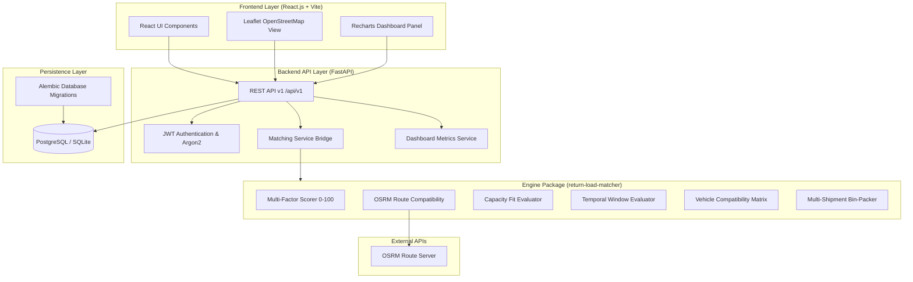

# System Architecture & Design

The **Empty Return Load Optimizer** is structured as a modular, production-ready monorepo separating domain logic, API server, data persistence, and interactive user interface.

## Monorepo Architecture Overview



## Component Responsibilities

| Component | Technology | Responsibilities |
| :--- | :--- | :--- |
| **`/engine`** | Python 3.10+, pure dataclasses | Standalone, pip-installable algorithm package. Scores trip-shipment compatibility, evaluates detour penalties via OSRM, handles hard-rejections, and consolidates multi-shipment loads. **Zero DB/Web framework dependencies.** |
| **`/backend`** | Python FastAPI, Async SQLAlchemy, PyJWT | REST API provider. Manages user authentication (Carrier & Shipper roles), database models (`User`, `Truck`, `Trip`, `Shipment`, `Match`, `Booking`), and connects engine scoring with persistent storage. |
| **`/frontend`** | React 18, Vite, TailwindCSS v4 | Dark-mode glassmorphic web dashboard. Provides Carrier & Shipper workflows, Leaflet map views with route polyline geometry, and Recharts ROI/environmental impact analytics. |
| **`/docs`** | Markdown | Technical documentation, algorithm math, architecture diagrams, API specs, and integration guidelines. |
```
